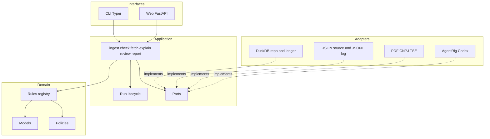
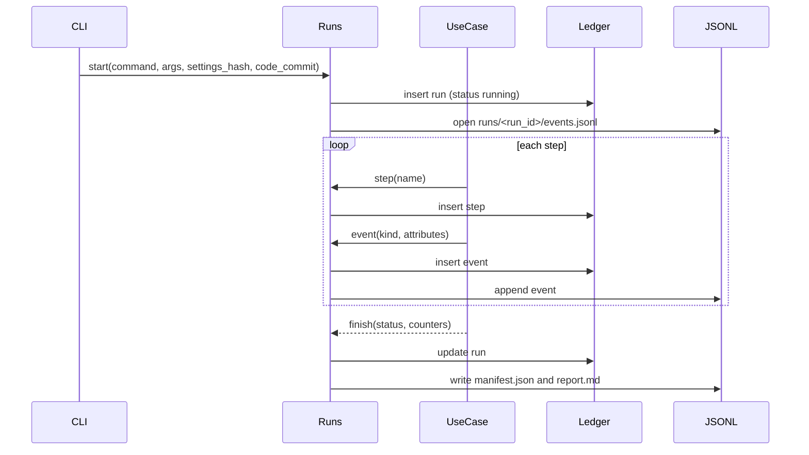

# OPSIU — technical architecture

Companion to [PLAN.md](PLAN.md). The product plan says what the audit does; this
document says how the code is organized so that every step is traceable,
reusable, and reconstructible after the fact.

## Principles

1. **Layered, one package.** `opsiu` is a single installable package with four
   layers. Dependencies point inward only: interfaces → application → domain,
   adapters → domain. The domain layer imports nothing from the others.
2. **Deterministic core, probabilistic edge.** Rules are code and SQL. Agents
   never decide whether a rule was broken; they annotate findings the rules
   produced.
3. **Everything is a run.** Every command creates a `run` with a stable id,
   writes `steps` and `events`, and ends with a status. No side effect happens
   outside a run.
4. **Nothing is overwritten.** Findings, decisions, agent traces, and external
   snapshots are versioned or appended. Superseded rows stay with a status.
5. **Provenance on every row.** A finding can be traced back to the source
   file hash, the record, the rule version and git commit, the run and step,
   and any agent call and human decision that touched it.
6. **Documented by default.** Each run emits a markdown report. Architecture
   decisions live in ADRs. Incidents follow a post-mortem template.

## Layers and package layout

```text
opsiu/
  pyproject.toml                 # uv-managed; ruff, mypy strict, pytest config
  uv.lock
  opsiu.toml                     # default configuration (paths, caps, sampling)
  src/opsiu/
    domain/                      # pure types and rules; no I/O
      models.py                  # Despesa, Deputado, Finding, Decision, Provenance
      money.py                   # Decimal helpers, BRL parsing
      rules/
        base.py                  # Rule protocol, RuleDescriptor, RuleResult
        registry.py              # explicit list of rule classes
        r01_locacao_veiculos.py  # one module per rule, SQL + evaluator
        ...
      policies.py                # caps, quota table, leadership add-ons as data
    application/                 # use cases; orchestrates domain + ports
      ports.py                   # Protocols: Repository, Ledger, PdfSource, CnpjSource, TseSource, Clock
      runs.py                    # Run lifecycle: start, step, event, finish
      ingest.py                  # load JSON -> despesas
      check.py                   # run rules -> findings (upsert versioned)
      fetch.py                   # external snapshots: tse, cnpj, pdf
      explain.py                 # sample findings -> agents -> pareceres
      review.py                  # record human decisions
      report.py                  # exports and run reports
    adapters/                    # implementations of ports
      duckdb/
        connection.py
        migrations/              # 0001_init.sql, 0002_...; applied in order, recorded
        repository.py
        ledger.py                # runs, steps, events, agent_traces
      files/
        json_source.py           # streaming reader for data/Ano-*.json with hashing
        jsonl_log.py             # append-only runs/<run_id>/events.jsonl
      external/
        pdf.py                   # download with cache, text extraction
        cnpj_bulk.py             # Receita dump loader, filtered to known CNPJs
        tse.py                   # candidate CSV loader
      agents/
        contracts.py             # AgentContract + codecs per agent (PT)
        runtimes.py              # Codex runtime factory, scripted runtimes
        trace.py                 # PrivateTraceRecorder -> agent_traces table
    interfaces/                  # entry points; thin
      cli/                       # Typer app: ingest, check, fetch, explain, review, report, runs
      web/                       # FastAPI + Jinja2 + HTMX review app
        app.py  routes/  templates/
    settings.py                  # pydantic-settings; loads opsiu.toml + env
  .llms/                         # agent-facing rules, skills, commands, tasks (PT)
  docs/
    adr/                         # 0001-layered-package.md, ...
    runbooks/                    # one per CLI command
    diagrams/                    # mermaid sources
    postmortem-template.md
    CHANGELOG.md                 # rule version history and schema migrations
  runs/                          # generated: <run_id>/report.md, events.jsonl, manifest.json
  tests/
    unit/  contract/  integration/
    fixtures/mini_dataset/       # ~200 synthetic records covering every rule
  evals/
    labeled_findings.jsonl       # human-labeled set for agent evals
    graders.py
```



## Domain: core types

- `Despesa`: typed view of one JSON record. Amounts are `Decimal`; `cnpj_cpf`
  is digits only with a `PayerKind` enum; `competencia` is `(ano, mes)`.
- `Finding`: `finding_key` (rule_id, rule_version, id_documento), `severity`,
  `amount`, `evidence` (JSON), `status`
  (`active` / `superseded`), `provenance`.
- `Provenance`: `run_id`, `step_id`, `source_file`, `source_sha256`,
  `record_sha256`, `rule_id`, `rule_version`, `code_commit`, `created_at`.
- `Decision`: `finding_key`, `decision` (`aprovado` / `rejeitado` / `revisar`),
  `reviewer`, `comment`, `decided_at`. Append-only; the latest row is current.
- `Parecer`: agent output tied to a `finding_key` and an `agent_trace_id`.

### Rule protocol

```python
class Rule(Protocol):
    descriptor: RuleDescriptor      # id, version, title, severity, fundamento, needs
    sql: str                        # DuckDB query returning candidate rows
    def evaluate(self, row: Mapping[str, object]) -> RuleResult | None: ...
```

- `descriptor.needs` lists required tables (`tse_candidatos`, `cnpj_socios`);
  `check` skips a rule, with a recorded `step` status `skipped`, when a needed
  table is absent.
- `version` is bumped whenever `sql` or `evaluate` changes; `CHANGELOG.md`
  records why. Findings from old versions become `superseded`.
- `registry.py` is the single source of truth. A test asserts that every
  registered rule has a matching `.llms/rules/<id>-*.md` and vice versa, and
  that the markdown frontmatter `version` equals the code version.

### Policies as data

Caps, the state quota table, and leadership add-ons live in `policies.py` as
frozen dataclasses with `valid_from` dates, loaded into DuckDB tables at
ingest. Rules read them from tables, so a future year-by-year table needs no
rule changes.

## Application: run lifecycle

Every CLI command and web action goes through `runs.py`.



- `run_id` is a UUIDv7 (time-ordered). It is also the AgentRig `RunId` when
  agents execute, so AgentRig events land in the same ledger.
- A failure inside a step is recorded as an `event` with kind `step.failed`
  and the normalized error; the run continues and finishes with status
  `completed_with_errors`. Only configuration errors abort a run.
- `manifest.json` captures: command, arguments, `opsiu.toml` hash, git commit
  and dirty flag, Python and package versions, source file hashes, rule
  versions used, model name and prompt versions, counters.
- `report.md` is rendered from the ledger: what ran, how long, what was
  produced, what failed, with links to findings and traces.

### Idempotency

- `ingest` is keyed by `source_sha256`; an unchanged file is skipped.
- `check` upserts findings by `finding_key`. Rows for a rule version that no
  longer fire are marked `superseded` in the same run.
- `fetch` stores snapshots with a `snapshot_id` and `fetched_at`; rules
  reference the snapshot used.
- `explain` never re-calls an agent for the same `(finding_key, prompt_version,
  model)` unless `--force`.

## Adapters

### DuckDB schema (migrations)

| Table | Purpose |
| --- | --- |
| `schema_migrations` | applied migration ids and timestamps |
| `source_files` | path, sha256, size, ingested_at, run_id |
| `despesas` | typed records plus `record_sha256`, `source_file_id` |
| `deputados`, `cota_uf`, `adicionais`, `caps` | reference data with `valid_from` |
| `tse_candidatos`, `cnpj_empresas`, `cnpj_socios`, `nf_texto` | external snapshots with `snapshot_id` |
| `runs`, `steps`, `events` | ledger |
| `finding_records` | immutable versioned findings with provenance columns |
| `finding_supersessions` | append-only supersession time and originating run |
| `findings` (view) | stable finding read schema with current lifecycle status |
| `pareceres` | agent outputs linked to `agent_traces` |
| `agent_traces` | full prompt, response, model, usage, duration, status |
| `decisions` | append-only human decisions |

Migrations are plain SQL files applied in order and recorded; a migration is
never edited after it is committed.

Finding publication inserts immutable records and supersession events in one
transaction. Foreign keys from PDF and agent records target `finding_records`;
readers use `findings`. This avoids DuckDB's indexed-update foreign-key limitation
without removing constraints or changing historical evidence (ADR 0010).

### Agents (AgentRig)

- One `AgentContract` per agent in `contracts.py`, all `READ_ONLY`, network
  denied, `max_turns=1`, `max_tool_calls=0`, structured output schema.
- Codecs validate strictly in both directions; invalid output is a recorded
  failure, not a parsed guess.
- `trace.py` implements AgentRig's `PrivateTraceRecorder` to write prompt,
  response, and usage into `agent_traces`. The AgentRig event sink writes to
  the same `events` table via the run ledger.
- Every agent has a `ScriptedAgentRuntime` fixture; live Codex requires
  `AGENTRIG_RUN_LIVE=1` and a configured budget (`max_agent_calls_per_run`).
- Prompt text and `prompt_version` live in `.llms/tasks/*.md`; the code loads
  them, hashes them, and records both version and hash in the trace.

### External sources

- Every fetch writes raw bytes to `data/external/<source>/<snapshot_id>/`
  plus a `manifest.json` with URL, headers, sha256, and time. Loaders read
  from the snapshot, never straight from the network, so a load can be
  replayed.
- PDF text extraction records the extractor name and version; PDFs with no
  text are flagged `needs_ocr`.

## Interfaces

### CLI (Typer)

`python3 -m opsiu <command>`: `ingest`, `check`, `fetch tse|cnpj|pdf`,
`explain`, `review` (starts the web app), `report`, `runs list|show <id>`,
`db migrate`. Every command prints its `run_id` first and the report path last.

### Web review app

FastAPI inside the package, calling `application.review` directly. Single local
user; `reviewer` comes from settings. Each approve/reject is a run with one
step, so the decision trail is in the ledger like everything else. Templates
are server-rendered; HTMX handles partial updates. No frontend build.

## Configuration

`settings.py` loads `opsiu.toml` into typed sections and lets `OPSIU_*`
environment variables override. Sections: `paths`, `years`, `sampling`,
`agents` (model, budget), `review` (reviewer name), `external` (URLs). The
settings hash is part of every run manifest.

## Observability and post-mortem

- Structured JSON logging with `run_id` and `step_id` on every line, written
  to `runs/<run_id>/log.jsonl` and mirrored to stderr at INFO.
- `opsiu runs show <id>` prints the run, its steps, failures, and produced
  artifacts; `--events` dumps the full event stream.
- `docs/postmortem-template.md` sections: summary, timeline (from the ledger),
  impact (findings affected, decisions affected), root cause, what the
  manifest showed, corrective actions, follow-up ADR if the design changed.
- Reproducing a past run: check out the recorded commit, restore the recorded
  snapshots, run the same command with the recorded arguments.

## Testing and quality gates

| Lane | Scope | Marker |
| --- | --- | --- |
| unit | domain models, each rule against the mini dataset, policies | `unit` |
| contract | ports vs adapters, agent codecs with scripted runtimes, registry vs `.llms/rules` | `contract` |
| integration | full CLI commands on the fixture dataset in a temp DuckDB | `integration` |
| eval | agent recommendations vs `labeled_findings.jsonl` with graders | `eval` (opt-in) |

Gates: `ruff check`, `ruff format --check`, `mypy --strict`, `pytest -m "not
eval"`. Live Codex tests are excluded unless `AGENTRIG_RUN_LIVE=1`.

## Documentation set

- `docs/adr/`: one file per decision, starting with the choices already made
  (layered package, DuckDB ledger, versioned findings, full agent traces,
  TOML settings, Typer, FastAPI in-package).
- `docs/runbooks/`: one per command: purpose, inputs, outputs, failure modes,
  how to re-run.
- `docs/CHANGELOG.md`: rule version bumps, schema migrations, prompt version
  bumps.
- `runs/<run_id>/report.md`: generated, committed only when a run is worth
  keeping as evidence.

## Implementation order

1. Package skeleton, `pyproject.toml`, settings, DuckDB migrations, run ledger,
   CLI with `runs` and `db migrate`. ADRs 0001–0007.
2. Domain models, policies, `ingest` with hashing and the mini fixture dataset.
3. Rule protocol, registry, R01–R10 and R14 with tests; `check` with versioned
   upsert; registry-vs-`.llms` contract test.
4. External snapshots and loaders; R11–R13.
5. Agent contracts, codecs, scripted runtimes, trace recorder; `explain` with
   sampling and budget.
6. Review web app and `decisions`.
7. `report`, run reports, runbooks, CHANGELOG, post-mortem template.
8. Evals and labeled set.

## Open points

- OCR for scanned PDFs: deferred; `needs_ocr` flag keeps them visible.
- Year-by-year caps: policies already carry `valid_from`, data still to be
  researched.
- Disk budget for the Receita dump and PDF cache: set limits in `opsiu.toml`
  once the first filtered load is measured.
