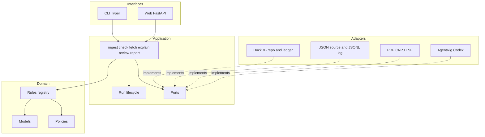
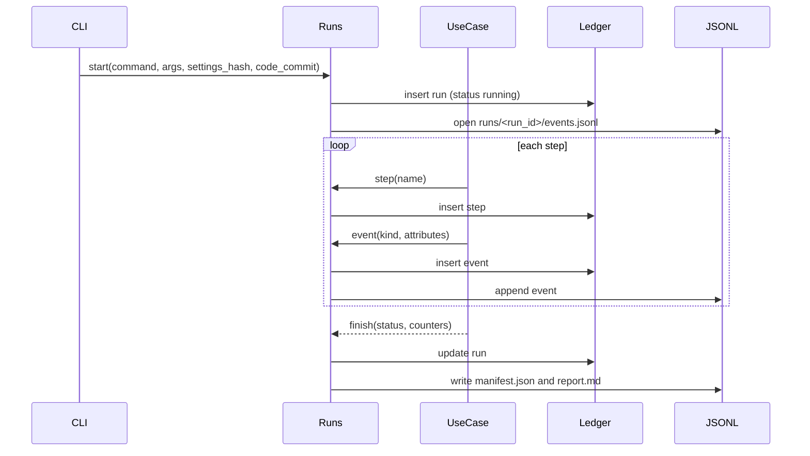

# OPSIU — technical architecture

Companion to [PLAN.md](PLAN.md). The product plan says what the audit does; this
document says how the code is organized so that every step is traceable,
reusable, and reconstructible after the fact.

## Principles

1. **Layered, one package.** `opsiu` is a single installable package with four
   layers. Dependencies point inward: application → domain; adapters implement
   application ports and use domain types; interfaces compose those adapters
   with application use cases. The domain layer imports nothing from the others.
2. **Deterministic core, probabilistic edge.** Rules are code and SQL. Agents
   never decide whether a rule was broken; they annotate findings the rules
   produced.
3. **Everything is a run.** Every command creates a `run` with a stable id,
   writes `steps` and `events`, and ends with a status. No side effect happens
   outside a run.
4. **Nothing is overwritten.** Findings, decisions, agent traces, and external
   snapshots are versioned or appended. Superseded rows stay with a status.
5. **Provenance on every row.** A finding can be traced back to the source
   file hash, the record, the rule version and git commit, the run and step,
   and any agent call and human decision that touched it.
6. **Documented by default.** Each run emits a markdown report. Architecture
   decisions live in ADRs. Incidents follow a post-mortem template.

## Layers and package layout

```text
opsiu/
  pyproject.toml                 # uv-managed; ruff, mypy strict, pytest config
  uv.lock
  opsiu.toml                     # default paths, audit years, margins and budgets
  src/opsiu/
    domain/                      # pure types and rules; no I/O
      models.py                  # Despesa, Competencia, PayerKind, Deputado
      findings.py                # Finding, Provenance, SourceOrigin
      decisions.py               # immutable human decisions
      money.py                   # Decimal helpers, BRL parsing
      rules/
        base.py                  # Rule protocol, RuleDescriptor, RuleResult
        registry.py              # explicit list of rule classes
        r01_locacao_veiculos.py  # one module per rule, SQL + evaluator
        ...
      policies.py                # caps, quota table, leadership add-ons as data
    application/                 # use cases; orchestrates domain + ports
      ports.py                   # Protocols: Repository, Ledger, PdfSource, CnpjSource, TseSource, Clock
      runs.py                    # Run lifecycle: start, step, event, finish
      ingest.py                  # load JSON -> despesas
      check.py                   # run rules -> immutable findings + supersession
      fetch.py                   # external snapshots: tse, cnpj, pdf
      explain.py                 # sample findings -> agents -> pareceres
      consolidate.py             # exact opinion inputs -> deputy summaries
      review.py                  # record human decisions
      report.py                  # all-active findings export
      final_report.py            # current human-approved findings export
      run_report.py              # pure renderer over public ledger records
    adapters/                    # implementations of ports
      duckdb/
        connection.py
        migrations/              # 0001_init.sql, 0002_...; applied in order, recorded
        repository.py
        ledger.py                # runs, steps, events
        annotation_repository.py # append-only explanation/invoice annotations
        summary_repository.py    # immutable summaries and their exact inputs
        review_repository.py     # original evidence and human decision history
      files/
        json_source.py           # streaming reader for data/Ano-*.json with hashing
        jsonl_log.py             # events, logs, manifest and run report
        artifacts.py             # exclusive run-scoped business artifacts
      external/
        pdf.py                   # download with cache, text extraction
        cnpj_bulk.py             # Receita dump loader, filtered to known CNPJs
        tse.py                   # candidate CSV loader
      agents/
        contracts.py             # AgentContract + codecs per agent (PT)
        runtimes.py              # Codex runtime factory, scripted runtimes
        trace.py                 # private trace recorder and invocation wrapper
    interfaces/                  # entry points; thin
      cli/                       # Typer app: ingest, check, fetch, explain, review, report, runs
      web/                       # FastAPI + Jinja2 + HTMX review app
        app.py  runtime.py  security.py  templates/  static/
    settings.py                  # pydantic-settings; loads opsiu.toml + env
  .llms/                         # versioned rules, tasks and scripted scenarios (PT)
  docs/
    adr/                         # 0001-layered-package.md, ...
    runbooks/                    # one per CLI command
    diagrams/                    # mermaid sources
    postmortem-template.md
    CHANGELOG.md                 # rule version history and schema migrations
  runs/                          # generated: <run_id>/report.md, events.jsonl, manifest.json
  evals/                         # development-only labels, AgentRig grader, traced runner
  tests/
    unit/  contract/  integration/  eval/
    fixtures/mini_dataset/       # 200 synthetic expense records; external fixtures separate
```

The layout above describes the implemented package. `evals/` is development
support, not a second installed package. Its runner composes the existing ports
and adapters with a run-local database; it never writes to the configured
production database. See [the evaluation guide](evals/README.md).



## Domain: core types

- `Despesa`: typed view of one JSON record. Amounts are `Decimal`; `cnpj_cpf`
  is digits only with a `PayerKind` enum; `competencia` is `(ano, mes)`.
- `Finding`: `finding_key` (rule_id, rule_version, id_documento; plus optional
  source-record discriminator for nonpositive document IDs, ADR 0013), `severity`,
  `amount`, `evidence` (JSON), `status`
  (`active` / `superseded`), `provenance`.
- `Provenance`: `run_id`, `step_id`, `code_commit`, `created_at`, and a
  `SourceOrigin` containing source ID/path, file hash and raw-record hash.
  Rule identity and version belong to the finding itself.
- `Decision`: `decision_id`, `finding_key`, `decision` (`aprovado` / `rejeitado`
  / `revisar`), `reviewer`, `comment`, `decided_at`, `run_id`, `step_id`.
  Append-only; latest `(decided_at, decision_id)` determines the current row.
- `Parecer`: strict agent output defined in the AgentRig adapter; its persisted
  annotation links a `finding_key` to an `agent_trace_id` and invocation metadata.

### Rule protocol

```python
class Rule(Protocol):
    descriptor: RuleDescriptor      # id, version, title, severity, fundamento, needs
    sql: str                        # DuckDB query returning candidate rows
    def evaluate(self, row: Mapping[str, object]) -> RuleResult | None: ...
```

- `descriptor.needs` lists required tables (`tse_candidatos`, `cnpj_socios`);
  `check` skips a rule, with a recorded `step` status `skipped`, when a needed
  relation is absent. External rules also validate loaded coverage and snapshot
  provenance; an existing empty table is not proof that the required source was loaded.
- `version` is bumped whenever `sql` or `evaluate` changes; `CHANGELOG.md`
  records why. Findings from old versions become `superseded`.
- `registry.py` is the single source of truth. A test asserts that every
  registered rule has a matching `.llms/rules/<id>-*.md` and vice versa, and
  that the markdown frontmatter `version` equals the code version.

### Policies as data

Caps, the state quota table, and leadership add-ons live in `policies.py` as
frozen dataclasses with `valid_from` dates, loaded into DuckDB tables at
ingest. Rules read them from tables, so a future year-by-year table needs no
rule changes.

## Application: run lifecycle

Every CLI command and web action goes through `runs.py`.



- `run_id` is a UUIDv7 (time-ordered). It is also the AgentRig `RunId` when
  agents execute, so AgentRig events land in the same ledger.
- A failure inside a step is recorded as an `event` with kind `step.failed`
  and the normalized error; the run continues and finishes with status
  `completed_with_errors`. Configuration errors and interruptions such as
  `KeyboardInterrupt` abort a run; ordinary failures outside a step also produce
  `completed_with_errors`.
- `manifest.json` captures: command, arguments, `opsiu.toml` hash, git commit
  and dirty flag, Python and package versions, source file hashes, rule
  versions used, model name and prompt versions, counters.
- `report.md` is rendered from public ledger records: command and arguments,
  duration, step states, counters, failures, skipped-step reasons, artifact links,
  and finding/trace IDs linked to their public events. It never reads private
  agent captures. It is a ledger file, not a business artifact counted by exporters.
- File-ledger creation precedes database access, so bootstrap and configuration
  failures remain inspectable without a usable database. Finalization writes
  the manifest before an exclusive report file. A report-write failure propagates
  and leaves the manifest/events intact; the already-recorded command outcome
  is not rewritten. See [runs](docs/runbooks/runs.md) for recovery.

### Idempotency

- `ingest` is keyed by `source_sha256`; an unchanged file is skipped.
- `check` inserts immutable records by `finding_key`. A complete successful
  evaluation appends supersession events for older active findings of that rule
  absent from the new result. Identical results preserve original provenance;
  changed evidence or recurrence of a superseded identity fails atomically
  instead of overwriting history (ADR 0009).
- `fetch` stores snapshots with a `snapshot_id` and `fetched_at`; rules
  reference the snapshot used.
- `explain` skips an existing successful annotation for the same finding,
  annotation kind, agent, prompt version and actual model unless `--force`.
  Consolidation instead keys reuse by deputy, exact input hash, model and prompt
  version. New opinion IDs change that input hash; forced calls append history.

## Adapters

### DuckDB schema (migrations)

| Table | Purpose |
| --- | --- |
| `schema_migrations` | applied migration ids and timestamps |
| `source_files` | path, sha256, size, ingested_at, run_id |
| `despesas` | typed records plus `record_sha256`, `source_file_id` |
| `despesas_current`, `deputados` (views) | current source projections; historical records remain stored |
| `cota_uf`, `adicionais`, `caps` | dated policy data with `valid_from` |
| `snapshots`, `tse_candidatos`, `cnpj_empresas`, `cnpj_socios`, `nf_texto` | external evidence with immutable snapshot references |
| `runs`, `steps`, `events` | ledger |
| `finding_records` | immutable versioned findings with provenance columns |
| `finding_supersessions` | append-only supersession time and originating run |
| `findings` (view) | stable finding read schema with current lifecycle status |
| `pareceres` | agent outputs linked to `agent_traces` |
| `agent_traces` | full prompt, response, model, usage, duration, status |
| `agent_trace_records` | append-only private trace chunks |
| `resumos_deputado`, `resumo_fontes` | deputy summaries and exact finding/opinion provenance |
| `decisions` | append-only human decisions |
| `findings_current` (view) | finding lifecycle plus latest human decision, including historical findings |

Migrations are plain SQL files applied in order and recorded; a migration is
never edited after it is committed.

Finding publication inserts immutable records and supersession events in one
transaction. Foreign keys from PDFs, agents, summaries and decisions target `finding_records`;
readers use `findings`. This avoids DuckDB's indexed-update foreign-key limitation
without removing constraints or changing historical evidence (ADR 0010).

### Agents (AgentRig)

- One `AgentContract` per agent in `contracts.py`, all `READ_ONLY`, network
  denied, `max_turns=1`, `max_tool_calls=0`, structured output schema.
- Codecs validate strictly in both directions; invalid output is a recorded
  failure, not a parsed guess.
- `trace.py` implements AgentRig's `PrivateTraceRecorder` and wraps invocation
  to capture complete requests and responses. Terminal metadata lives in
  `agent_traces`; chunked private captures live in `agent_trace_records`.
  Public AgentRig events enter the same run ledger with payloads excluded.
- Every agent has a `ScriptedAgentRuntime` fixture; live Codex requires
  literal `AGENTRIG_RUN_LIVE=1` and a positive `agents.max_calls_per_run` budget.
  A custom gate is additional. Scripted traces record model `scripted`, and
  failed attempts consume the same per-run budget as successful calls.
- Prompt text and `prompt_version` live in `.llms/tasks/*.md`; the code loads
  them, hashes them, and records both version and hash in the trace.

### External sources

- Each new capture writes raw bytes to `data/external/<source>/<snapshot_id>/`
  plus a `manifest.json` with URL, headers, sha256, and time. Loaders read
  from the snapshot, never straight from the network, so a load can be
  replayed.
- PDF text extraction records the extractor name and version; PDFs with no
  text are flagged `needs_ocr`.

## Interfaces

### CLI (Typer)

`python3 -m opsiu <command>`: `ingest`, `check`, `fetch tse|cnpj|pdf`,
`explain`, `review` (starts the web app), `report findings|final`,
`runs list|show <id>`, `db migrate|status`. Invoked command bodies print their
`run_id` first and report path last. Typer help and argument-parser errors occur
before command dispatch and do not create runs.

### Web review app

FastAPI inside the package, calling `application.review` directly. Single local
user; `reviewer` comes from settings. Each approve/reject is a run with one
step, so the decision trail is in the ledger like everything else. Read requests
also have independent runs. Templates are server-rendered; locally bundled HTMX
handles partial updates, with ordinary form submission as a fallback. No frontend
build. The server binds to loopback and validates Host, form tokens and supplied
origins. Cached PDF bytes are verified before serving.

The pending list contains active undecided findings and findings whose latest
decision is `revisar`. Superseded findings keep their evidence and decision history
but cannot receive new decisions. Final reports select only active findings with
the latest human decision `aprovado`, from one database snapshot. Agent summaries
containing other findings do not enter that export.

## Configuration

`settings.py` loads `opsiu.toml` into typed sections and lets `OPSIU_*`
environment variables override. Sections: `paths`, `years`, `sampling`, `rules`
(quota margin), `agents` (model, budget), `review` (reviewer name), `external`
(URLs). Precedence is explicit values, nested environment overrides, TOML, then
defaults. Paths resolve from the working directory. The effective settings hash
is part of every run manifest.

## Observability and post-mortem

- Structured JSON logging with `run_id` and `step_id` on every line, written
  to `runs/<run_id>/log.jsonl` and mirrored to stderr at INFO.
- `opsiu runs show <id>` prints the run, its steps, failures, and report path;
  `--events` dumps public ledger events. The report links produced artifacts.
- `docs/postmortem-template.md` sections: summary, timeline (from the ledger),
  impact (findings affected, decisions affected), root cause, what the
  manifest showed, corrective actions, follow-up ADR if the design changed.
- Reproducing a past run: check out the recorded commit, restore the recorded
  snapshots, run the same command with the recorded arguments.

## Testing and quality gates

| Lane | Scope | Marker |
| --- | --- | --- |
| unit | domain models, each rule against the mini dataset, policies | `unit` |
| contract | ports vs adapters, agent codecs with scripted runtimes, registry vs `.llms/rules` | `contract` |
| integration | full CLI commands on the fixture dataset in a temp DuckDB | `integration` |
| eval | agent recommendations vs synthetic labels with AgentRig graders | `eval` (opt-in) |

From `opsiu/`: `uv run ruff check .`, `uv run ruff format --check .`,
`uv run mypy` (strict in `pyproject.toml`), `uv run pytest -m "not eval"`.
Ordinary tests use scripted/fake runtimes; live evaluation requires its explicit gate.
The repository-level [GitHub Actions workflow](../.github/workflows/opsiu.yml)
runs these gates on push and pull request with Python 3.12 and `uv sync --locked`.
It caches uv dependencies, uses read-only repository permissions, and sets the
live gate to `0`. The workflow lives at the repository root for GitHub discovery;
all product source and test code remains under `opsiu/`.

## Documentation set

- `docs/adr/`: one file per decision, starting with the choices already made
  (layered package, DuckDB ledger, versioned findings, full agent traces,
  TOML settings, Typer, FastAPI in-package).
- `docs/runbooks/`: one per command: purpose, inputs, outputs, failure modes,
  how to re-run.
- `docs/CHANGELOG.md`: rule version bumps, schema migrations, prompt version
  bumps.
- `runs/<run_id>/report.md`: generated and git-ignored with the other run evidence.

## Implementation order

1. Package skeleton, `pyproject.toml`, settings, DuckDB migrations, run ledger,
   CLI with `runs` and `db migrate`. ADRs 0001–0007.
2. Domain models, policies, `ingest` with hashing and the mini fixture dataset.
3. Rule protocol, registry, R01–R10 and R14 with tests; `check` with versioned
   publication; registry-vs-`.llms` contract test.
4. External snapshots and loaders; R11–R13.
5. Agent contracts, codecs, scripted runtimes, trace recorder; `explain` with
   sampling and budget.
6. Review web app and `decisions`.
7. `report`, run reports, runbooks, CHANGELOG, post-mortem template.
8. Evals and labeled set.

## Open points

- OCR for scanned PDFs: deferred; `needs_ocr` flag keeps them visible.
- Year-by-year caps: policies already carry `valid_from`, data still to be
  researched.
- Disk budget for the Receita dump and PDF cache: automatic disk-budget settings
  are not implemented; measure storage needs before designing retention or limits.
