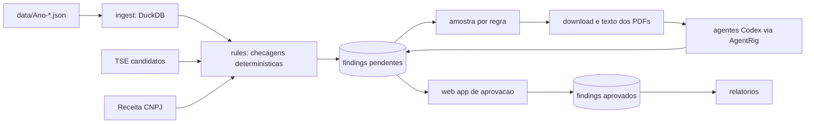

# OPSIU — plano do enxame de agentes para fiscalizar a CEAP

Objetivo: auditar os reembolsos da Cota para o Exercício da Atividade Parlamentar
(arquivos em `data/Ano-*.json`) contra as regras de `opsiu/cota-parlamentar.md`,
com código determinístico detectando violações e agentes Codex (via AgentRig)
explicando, lendo notas fiscais e priorizando. Nada entra no relatório final sem
aprovação humana.

## Decisões já tomadas

| Tema | Decisão |
| --- | --- |
| Anos | 2023–2026 (57ª legislatura; valores atuais da cota se aplicam) |
| Runtime | AgentRig + Codex, já instalado em `.venv` |
| Regras para agentes | Pasta própria `opsiu/.llms/` com rules, skills, commands e tasks |
| Divisão de trabalho | Código sinaliza; agentes explicam, revisam PDFs e ranqueiam |
| Armazenamento | DuckDB em `data/opsiu.duckdb` |
| Topologia | Um agente por regra + orquestrador + revisor |
| Saída | Tabela `findings` (id do registro, regra, severidade, evidência, decisão) |
| Rigor | Conservador: só violações claras |
| Aprovação | Obrigatória, via web app |
| Orçamento Codex | Pequeno: amostra limitada por regra |
| Idioma | Português em regras, prompts e relatórios |
| Dados externos | PDFs das notas, dump CNPJ da Receita, candidatos do TSE |
| Teto da cota | Valores atuais, sinalizar só acima de uma margem |
| Lideranças | Incluídas, com adicional de liderança |
| Execução | Manual, um comando por etapa |

## Estrutura de pastas

```text
opsiu/
  PLAN.md
  cota-parlamentar.md              # fonte das regras
  .llms/
    AGENTS.md                      # contrato geral do enxame (PT)
    rules/                         # uma regra por arquivo, frontmatter YAML
      R01-locacao-veiculos.md
      R02-taxi-pedagio-estacionamento.md
      ...
    skills/                        # procedimentos reutilizáveis para agentes
      ler-nota-fiscal.md
      consultar-cnpj.md
      calcular-teto-mensal.md
      redigir-parecer.md
    commands/                      # documentação dos comandos CLI
      ingest.md  check.md  fetch.md  explain.md  review.md  report.md
    tasks/                         # modelos de tarefa por etapa do pipeline
      explicar-achado.md
      revisar-nota.md
      consolidar-deputado.md
  src/opsiu/
    ingest/      # JSON -> DuckDB, normalização
    external/    # CNPJ (Receita), TSE, download e texto de PDFs
    rules/       # checagens determinísticas -> findings
    agents/      # AgentRig: contratos, codecs, runtimes, orquestrador
    review/      # web app de aprovação
    reports/     # exportação final
    cli.py       # `python3 -m opsiu <comando>`
  tests/         # unitários + contratos com runtimes scriptados
  evals/         # conjunto rotulado + graders AgentRig
```

## Fluxo



## Modelo de dados (DuckDB)

- `despesas`: uma linha por registro do JSON, com colunas tipadas:
  `valor_documento`, `valor_glosa`, `valor_liquido` como DECIMAL;
  `cnpj_cpf_digits` só dígitos; `tipo_pagador` = `CNPJ` (14 dígitos), `CPF`
  (11) ou `OUTRO`; `competencia` = `ano`/`mes`; `categoria_id` =
  `numeroSubCota`.
- `deputados`: derivada de `despesas` (id, nome, UF, partido, legislatura),
  mais flag `lideranca` quando `cpf` vazio e `siglaUF = 'NA'`.
- `cota_uf`: tabela da seção "Valor da Cota" do markdown; `adicionais` com os
  valores de liderança.
- `tse_candidatos`: id/nome/CPF dos candidatos de 2024 e 2026.
- `cnpj_empresas`, `cnpj_socios`: do dump da Receita, apenas os CNPJs presentes
  em `despesas` (filtrar na carga para reduzir tamanho).
- `nf_texto`: texto extraído dos PDFs baixados, por `idDocumento`.
- `findings`: `id`, `id_documento`, `regra`, `severidade`, `valor_envolvido`,
  `evidencia` (JSON), `parecer_agente` (JSON, opcional), `decisao`
  (`pendente`/`aprovado`/`rejeitado`), `revisor`, `revisado_em`.

## Regras determinísticas (fase 2)

Só regras que os dados permitem afirmar com segurança. Cada uma vira um módulo
em `src/opsiu/rules/` e um arquivo em `.llms/rules/` com: id, fundamento legal
(trecho do markdown), campos usados, lógica, severidade, exemplos positivos e
negativos, e o que o agente deve verificar na nota.

| Regra | Checagem | Fonte |
| --- | --- | --- |
| R01 | Locação de veículos > R$ 12.713,00 por deputado/mês | subcota, soma mensal |
| R02 | Táxi, pedágio e estacionamento > R$ 2.700,00/mês | idem |
| R03 | Combustíveis > R$ 9.392,00/mês | idem |
| R04 | Segurança > R$ 8.700,00/mês | idem |
| R05 | Cursos e eventos > R$ 7.697,17/mês | idem |
| R06 | Complemento de auxílio-moradia > R$ 4.148,80/mês | idem |
| R07 | Gasto acumulado no ano acima da cota da UF (com saldo acumulado e adicional de liderança); só acima de margem configurável | `cota_uf`, `adicionais` |
| R08 | Pagamento a CPF fora de locação de imóvel, aeronave/embarcação e táxi | `tipo_pagador`, subcota |
| R09 | Nota duplicada: mesmo fornecedor + número + valor em registros distintos (mesmo ou outro deputado) | agrupamento |
| R10 | Competência (`mes`/`ano`) mais de 90 dias após `dataEmissao` | datas |
| R11 | Divulgação nos 120 dias antes da eleição por deputado candidato | `tse_candidatos`, datas TSE |
| R12 | Fornecedor com sócio de mesmo sobrenome do deputado | `cnpj_socios`; sempre revisão humana |
| R13 | Fornecedor com natureza ou CNAE incompatível (supermercado em alimentação; serviço de motorista em locação) | `cnpj_empresas` + palavras-chave em `fornecedor` |
| R14 | Lideranças: aplicar R07 com adicional correspondente | `adicionais` |

Fora de escopo nesta versão: gastos de servidores da Câmara, parentesco até 3º
grau sem base pública, material permanente sem leitura da nota.

## Agentes (fase 4)

Todos como `ConfiguredAgent` do AgentRig com saída estruturada, sandbox
`READ_ONLY`, rede desligada, `max_turns=1`, `max_tool_calls=0`. Entrada e saída
são dataclasses tipadas com codecs estritos, como em
`experiment/codex_agent/example_codex_agent.py`.

| Agente | Entrada | Saída |
| --- | --- | --- |
| Explicador por regra (um por R01–R14) | achado + registro + texto da regra | `parecer`: fundamento, confiança, evidência citada, recomendação `manter`/`descartar`/`revisar` |
| Leitor de nota fiscal | texto do PDF + registro | campos extraídos (emitente, CNPJ, data, valor, descrição) e divergências |
| Revisor por deputado | achados mantidos de um deputado | resumo, ranking por severidade, pontos de atenção |

O orquestrador é código: seleciona amostra por regra (teto configurável, ex.
20 achados), baixa PDFs, extrai texto, chama os agentes, grava `parecer_agente`.
Um `ScriptedAgentRuntime` cobre cada agente nos testes; Codex só com
`AGENTRIG_RUN_LIVE=1`.

## Web app de aprovação (fase 5)

Suposição: FastAPI + Jinja2 + HTMX, servido com uvicorn, sem build de frontend.

- Lista de achados pendentes com filtros por regra, deputado, UF, valor.
- Página do achado: registro, regra, evidência, parecer do agente, link do PDF
  e texto extraído.
- Botões aprovar/rejeitar com comentário; grava `decisao`, `revisor`,
  `revisado_em`.
- Nada é exportado para relatório sem `decisao = aprovado`.

## Dados externos (fase 3)

- TSE: CSVs de candidatos 2024 (municipal) e 2026 (geral); cruzar por CPF
  quando houver, senão por nome normalizado + UF. Datas: 1º turno 06/10/2024 e
  04/10/2026; janela = 120 dias antes.
- Receita Federal: dump CNPJ (dezenas de GB). Carregar em DuckDB apenas
  empresas e sócios cujo CNPJ aparece em `despesas` (cerca de poucas dezenas de
  milhares), descartando o resto após a carga.
- PDFs: download com cache em `data/pdf/`, texto via `pypdf`/`pdfplumber`; sem
  OCR na primeira versão (marcar PDFs sem texto).

## Testes e evals (fase 6)

- Unitários por regra com casos sintéticos positivos e negativos.
- Contratos dos agentes com runtimes scriptados (sem rede).
- Eval: ~50 achados rotulados manualmente; graders AgentRig medem concordância
  da recomendação do agente; baseline guardado em `evals/`.

## Etapas e comandos

| Fase | Entregável | Comando |
| --- | --- | --- |
| 0 | Esqueleto, dependências (`duckdb`, `pypdf`, `httpx`, `fastapi`, `uvicorn`, `jinja2`), `.llms/` inicial | — |
| 1 | `despesas`, `deputados`, `cota_uf`, `adicionais` no DuckDB | `python3 -m opsiu ingest --anos 2023-2026` |
| 2 | R01–R10, R14 gerando `findings` | `python3 -m opsiu check --regras R01,...` |
| 3 | TSE, CNPJ filtrado, PDFs amostrados; R11–R13 | `python3 -m opsiu fetch tse\|cnpj\|pdf` |
| 4 | Pareceres dos agentes na amostra | `AGENTRIG_RUN_LIVE=1 python3 -m opsiu explain --amostra 20` |
| 5 | Web app de aprovação | `python3 -m opsiu review` |
| 6 | Testes, evals, relatório final | `python3 -m opsiu report` |

## Riscos

- Valores da cota e tetos mudaram ao longo da legislatura; R07 usa margem e
  marca resultado como aproximado.
- Dump da Receita exige espaço em disco e tempo; carga filtrada reduz, mas o
  download completo ainda é grande.
- PDFs escaneados sem texto exigem OCR futuro.
- Codex no plano Pro Lite tem janela semanal; a amostragem mantém o custo baixo.
